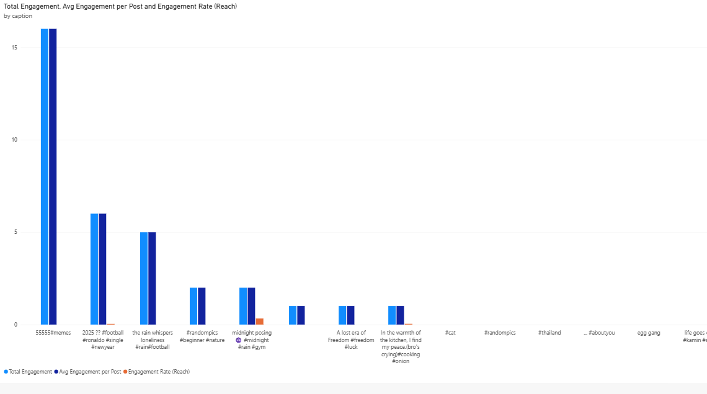
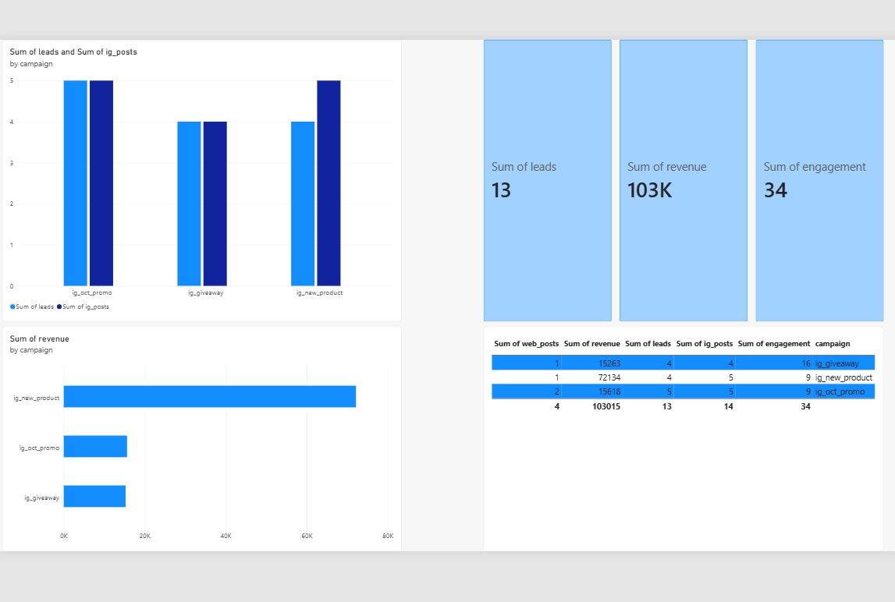

# Marketing Analytics Pipeline: Instagram + WordPress + Odoo

A small end-to-end data project that tracks how social content connects to website activity, leads and revenue.

## Architecture
Instagram Graph API ─┐
WordPress REST API ──┼─> Python (pandas) -> SQLite -> Power BI
Odoo CRM (XML-RPC) ──┘

## What it does
- Pulls post performance (likes, comments, reach, saves, shares) from Instagram
- Pulls website posts from WordPress and leads from Odoo CRM
- Loads everything into SQLite and joins it by campaign with SQL
- Visualizes engagement, leads and revenue per campaign in Power BI
- Includes pytest data-quality tests

## Tech stack
Python, pandas, SQL (SQLite), pytest, Docker, Power BI, Instagram Graph API, WordPress REST API, Odoo

## Dashboard

